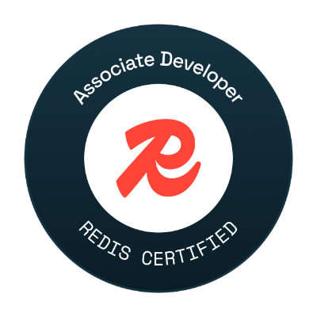

  <a href="https://github.com/Amansingh0807">
    <picture>
      <source media="(prefers-color-scheme: dark)" srcset="./groot-dark.gif">
      <source media="(prefers-color-scheme: light)" srcset="./groot-light.gif">
      
    </picture>
  </a>

<h1 align="center">Hi 👋, I'm Aman Singh</h1>
<h3 align="center">🚀 Software Engineer — building AI-powered products end to end, from LLM pipelines to production-grade backends</h3>

  
  
  
  

---

### 🧑‍💻 About Me

- 🎓 Final-year **B.Tech** student at **Guru Gobind Singh Indraprastha University** — CGPA **9.40/10** (Top 1% of my batch)
- 💼 Previously a **Launchpad Trainee at PwC Acceleration Center** — Rank 19 nationally, Rank 1 in college
- 🧪 Previously **Software Engineering Intern at Atlas Research** — built backend workflows supporting 100K+ concurrent users
- 🔭 Building **CLIQ Code**, an AI CLI coding agent with a custom C++ execution engine
- 🌱 Deep in **Generative AI, LLM orchestration, and distributed systems** right now
- 💬 Ask me about **Full-Stack Development, Cloud, GenAI/LLM apps, System Design, DSA, and Open Source**
- ⚡ Fun fact: I once explained recursion... by explaining recursion

---

### 🛠️ Tech Stack

  

<table align="center">
<tr>
<td valign="top" width="50%">

**Languages**
`C++` `TypeScript` `JavaScript` `Java` `SQL`

**Frameworks & Runtimes**
`Node.js` `Next.js` `React` `LangChain.js` `REST/Webhooks` `OAuth`

</td>
<td valign="top" width="50%">

**Databases**
`PostgreSQL` `MongoDB` `Redis` `Supabase` `Convex` `Prisma`

**Cloud, DevOps & Tools**
`Docker` `Kubernetes` `Google Cloud` `Terraform` `CI/CD` `n8n` `Git`

</td>
</tr>
</table>

**System Design:** Distributed Systems · High Availability · Concurrency · Performance Optimization · Low-Level Design

---

### 🚧 Featured Projects

| Project | What it does | Stack |
|---|---|---|
| 🧠 [**CLIQ Code**](https://github.com/Fliq-Odd/cliq-code) | AI CLI coding agent — 17-module C++ engine, 4+ LLM providers, sandboxed execution with 5 permission tiers, 40% faster dev workflows | `C++` `Python` `LiteLLM` `pybind11` |
| 📝 [**GenForm**](https://github.com/Amansingh0807/GenForm) | AI-powered SaaS to generate & publish dynamic web forms from natural language — 500+ active users, zero marketing spend | `Next.js` `React` `Gemini API` `Prisma` `Stripe` `Supabase` |
| 🛰️ [**VeNeck**](https://github.com/Fliq-Odd/veneck) | Real-time crowd intelligence platform tracking 10,000+ attendees with sub-second latency, perimeter breach detection | `Node.js` `Socket.IO` `Next.js` `Supabase` `Turf.js` `Leaflet` |

---

### 🌍 Open Source

- 55+ merged PRs on **[stdlib.js](https://github.com/stdlib-js/stdlib)**
- Many Others too

### 🏆 Achievements

- 🥇 Winner — Prod-e-G Hackathon (DSEU), out of 500+ teams
- 🥈 Runner-up — Hack-to-Skill & HackWave national hackathons
- 🏅 Finalist — Colosseum 2024, top teams out of 2 lakh+ students globally
- ☁️ **Google Cloud Associate Cloud Engineer** certified
- 📈 LeetCode Contest Rating: **1678**

---

---

### 🎖️ Certifications & Badges

  <table align="center">
    <tr>
      <td align="center" width="220">
        
         
        <b>Google Cloud ACE</b>
      </td>
      <td align="center" width="220">
        
         
        <b>Meshery Contributor</b>
         
        <a href="https://badges.layer5.io">Get your own badge</a>
      </td>
      <td align="center" width="220">
        
         
        <b>Redis Certified</b>
      </td>
    </tr>
  </table>

---

### 📊 GitHub Stats

  
  

  

  

---

### ✍️ Quote of the Day

  

---

### 💰 Support My Work

  
  
  
  

<h3 align="center">Thank you so much for visiting 🙏❤️</h3>
